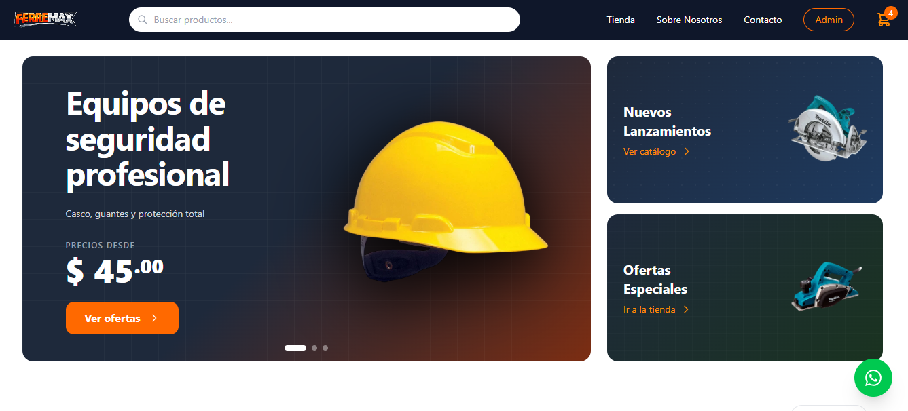

# Ferremax



Aplicación web para una ferretería que permite explorar herramientas y materiales de construcción, gestionar un carrito de compras y administrar las operaciones del negocio desde un panel interno.

## ✨ Características

### 🏪 Tienda

- Página de inicio con productos destacados.
- Catálogo con búsqueda, filtros por categoría, precio, calificación y disponibilidad, y opciones de ordenamiento.
- Detalle de productos.
- Carrito con control de cantidades y resumen de compra.
- Registro de datos del cliente y dirección de envío; creación de pedidos y ventas.
- Páginas informativas de la ferretería y contacto.

### 🔒 Administración

- Panel con secciones de ventas, pedidos, compras e inventario.
- Creación y administración de productos y categorías.
- Gestión de clientes, direcciones y proveedores.
- Registro de compras y seguimiento de estadísticas de inventario y ventas.
- Acceso de administrador configurado mediante variables de entorno.

## 🛠 Tecnologías

- React 19 + TypeScript
- Vite 7
- Tailwind CSS 4
- React Router 7
- Supabase para datos y almacenamiento de imágenes
- Lucide React para iconos

## 📍 Requisitos

- Node.js y npm.
- Un proyecto de Supabase con las tablas y recursos requeridos por la aplicación.
- Credenciales de Supabase y del administrador para la configuración local.

## 🚀 Instalación y ejecución

1. Clona el repositorio y entra en el directorio del proyecto.
2. Instala las dependencias:

   ```bash
   npm install
   ```

3. Copia `.env.template` a `.env` y completa las variables con los valores de tu entorno:

   ```env
   VITE_SUPABASE_URL=https://tu-proyecto.supabase.co
   VITE_SUPABASE_PUBLISHABLE_DEFAULT_KEY=tu-clave-publica
   VITE_ADMIN_USER='{"email":"admin@example.com","password":"tu-contraseña"}'
   ```

   En PowerShell puedes crear el archivo con:

   ```powershell
   Copy-Item .env.template .env
   ```

4. Inicia el servidor de desarrollo:

   ```bash
   npm run dev
   ```
